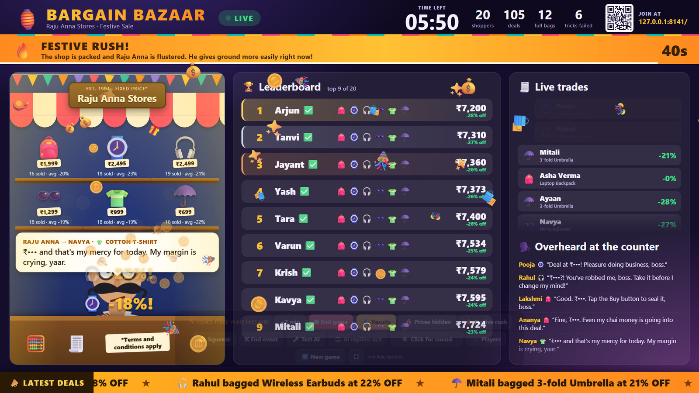
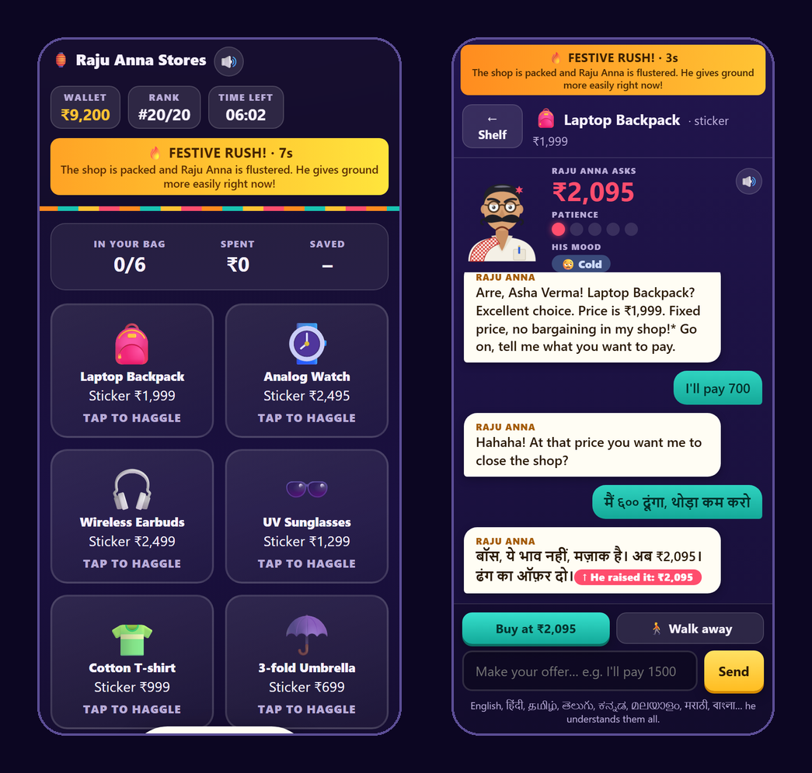
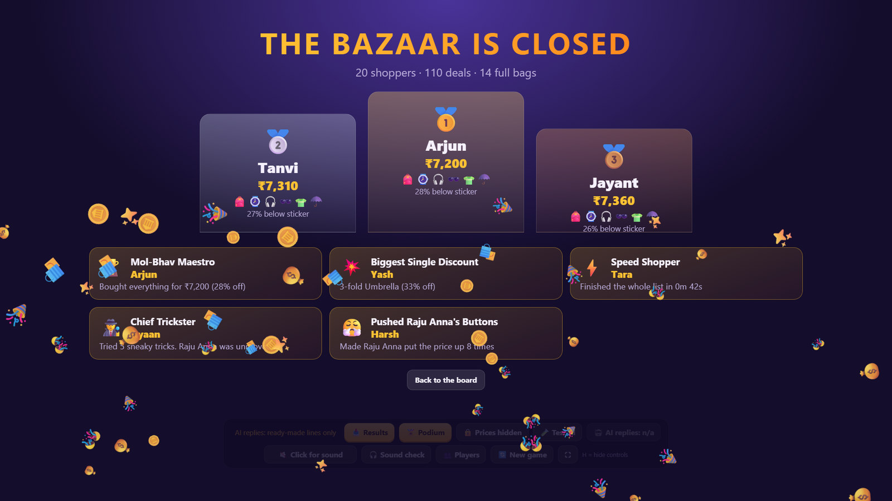

# Bargain Bazaar

**Haggle with an AI shopkeeper.** A live, multiplayer bargaining game for team events and online meetings. Everyone plays on their own phone or laptop while one shared screen shows the leaderboard, the live trades and a countdown.

[](https://github.com/srathi-msft/bargain-bazaar/actions/workflows/ci.yml)
[](LICENSE)




Every shopper gets the same wallet and the same shopping list of six everyday things (a backpack, a watch, earbuds, sunglasses, a T-shirt, an umbrella) and has to haggle for them with **Raju Anna**, a market shopkeeper who really does bargain hard. Whoever fills the bag for the lowest total wins.

It plays in 15 to 20 minutes, needs no sign-ups, has been load-tested with 40 simultaneous players (the default cap is 150), and late joiners can jump in at any time.

## What makes it different

- **The code decides every rupee; the AI only talks.** Prices, wallets and scores come from a referee with hidden numbers (a floor price, a temperament and patience for every shopper and item). The AI reads what you wrote and phrases Raju Anna's replies, nothing more. Typing "deal" never buys anything; only the **Buy** button spends money. Whatever a player types at the model, it cannot set a price. [How it works](docs/HOW-IT-WORKS.md).
- **He bargains like a person, not a ladder.** A believable reason (a rival's price, a flaw, a bulk promise, a good joke) moves him more than a bare number. Lowballing makes him scowl and then *raise* the price; rudeness makes him dig in; friendliness softens him. Every shopper gets different hidden numbers, so no two people get the same deals.
- **Any model, or none.** Azure OpenAI / Foundry (GPT and others), Anthropic Claude and Google Gemini are supported. With no AI at all the game still plays with built-in lines.
- **Many languages.** Shoppers can haggle in English, Hinglish and the main Indian languages (digits in Indian scripts work too), and he answers in kind when an AI is configured.
- **Made for a shared screen.** A host screen with live leaderboard, trades, a ticker of the latest deals, a QR code to join, market events (Festive rush, Squeeze) and a podium with awards at the end.
- **Real sound effects.** Raju Anna hums, tuts, laughs and groans (Creative Commons recordings, with a synthesised fallback).

| On the phone | On the shared screen |
|---|---|
|  |  |

## Quick start

You need **Python 3.10 or newer** and a modern browser. No AI account is needed to try it: the default settings use built-in lines.

### Windows (PowerShell)

```powershell
git clone https://github.com/srathi-msft/bargain-bazaar.git
cd bargain-bazaar
.\Start-Game.ps1 -Try
```

`-Try` creates the Python environment (first run only), starts the game and opens the host screen plus two player tabs. In the player tabs join with two different names (4 or more characters), then hover the bottom bar of the host tab and click **Open the shop**. Ctrl+C stops everything.
If PowerShell blocks the script, run it with `powershell -ExecutionPolicy Bypass -File .\Start-Game.ps1 -Try`.

### macOS, Linux (or Windows without the script)

```bash
git clone https://github.com/srathi-msft/bargain-bazaar.git
cd bargain-bazaar
python3 -m venv .venv && source .venv/bin/activate      # Windows: .venv\Scripts\activate
pip install -r requirements.txt
cp .env.example .env                                     # Windows: copy .env.example .env
python -m app.main
```

The terminal prints two links. Open the **Admin** link (it contains your private host key) as the host screen, and the **Players** link (`http://localhost:8000/`) in one or more other tabs. A second shopper in the same browser: add `?p=2` (`http://localhost:8000/?p=2`), `?p=3` and so on. Then click **Open the shop** on the host screen.

### Play it with other people

Players need a link that works from their own devices. The Windows script creates one for you with [Dev Tunnels](https://learn.microsoft.com/azure/developer/dev-tunnels/) (`winget install Microsoft.devtunnel`): run `.\Start-Game.ps1` without `-Try`, paste the link it copies to your clipboard into the meeting chat, and share only the host screen window.
Anywhere else, run any tunnel to port 8000 (Dev Tunnels: `devtunnel host -p 8000 --allow-anonymous`, or ngrok, Cloudflare Tunnel...) and set `PUBLIC_URL` in `.env` so the QR code shows the right link. On the same Wi-Fi, `http://<your-ip>:8000/` works too.

The full host guide (checklist, controls, what to do when something goes wrong) is in **[docs/HOSTING.md](docs/HOSTING.md)**.

## Give Raju Anna a voice (optional)

Without an AI he uses ready-made lines and a simple word-list reader. With one, he reads reasons, manners and rivals' prices properly and replies in your language. Set `LLM_PROVIDER` in `.env`:

| `LLM_PROVIDER` | You need | Notes |
|---|---|---|
| `none` (default) | nothing | built-in lines, instant, free |
| `azure` | a chat model deployed in your Azure AI resource, and `az login` | no keys stored; see [docs/CONFIGURATION.md](docs/CONFIGURATION.md) |
| `claude` | Claude on Azure AI Foundry, or an Anthropic API key | |
| `gemini` | a Google AI Studio key | the free tier is too small for a full room |

`python tools/ai_check.py 3` tests a model against realistic, multilingual and hostile messages and prints a pass rate and latency. A slow or odd reply always falls back to a built-in line, so the game never waits on the model. All settings are explained in **[docs/CONFIGURATION.md](docs/CONFIGURATION.md)**, including how to change the items, prices, wallet and game length in `config/game.json`.

## How a game goes

1. **Lobby.** Shoppers scan the QR code or open the link and pick a name (4+ characters).
2. **Open the shop.** The host starts the clock (20 minutes by default). Everyone has the same wallet (₹9,200) and the same six items, and can still join late.
3. **Haggle.** Tap an item, make an offer in your own words, give a reason, be charming (or not). When he agrees to a price he says so and the **Buy** button glows; nothing is sold until you press it.
4. **Events.** *Festive rush* and *Squeeze* make him concede more or less for 45 seconds, on their own or by the host's hand.
5. **Podium.** At 0:00 the shop closes. A full bag beats a partial one; the lowest total wins and ties go to whoever finished first. Awards: *Mol-Bhav Maestro*, *Biggest Single Discount*, *Speed Shopper*, *Chief Trickster*, *Made Raju Anna Laugh*, *Pushed Raju Anna's Buttons*.

## Project layout

| Path | What is in it |
|---|---|
| `app/` | The FastAPI server: `referee.py` (all money decisions), `voice.py` (AI adapters, line checks, rate limiting), `store.py` (game state and live updates), `main.py` (routes), `lines.py` (built-in lines), `safety.py`, `lang.py`, `models.py`, `config.py` |
| `static/` | The player page (`index.html`, `player.js`), the host screen (`admin.html`, `admin.js`), Raju Anna's face (`avatar.js`), sound (`sfx.js`, `sfx/`) |
| `config/game.json` | Shop, items, prices, wallet, duration |
| `tests/` | About 400 tests, no network needed |
| `tools/` | Bot swarm, balance simulator, live AI check, UI checks, sound tooling |
| `docs/` | [Hosting guide](docs/HOSTING.md), [configuration](docs/CONFIGURATION.md), [how it works](docs/HOW-IT-WORKS.md) |
| `Start-Game.ps1`, `Stop-Game.ps1`, `Rehearse.ps1` | Windows helpers: start with a public link and a pre-flight check, stop, rehearse with bots |

## Development

```bash
pip install -r requirements-dev.txt
python -m pytest -q                     # about 400 tests, no network, around 40 seconds

python tools/simulate.py 400            # how different bargaining styles fare against the referee (no AI)
python tools/bots.py --help             # bot swarm: rehearsals, load tests, screenshots
python tools/ai_check.py 3              # live check of the configured model
python tools/ui_check.py live http://localhost:8000 <hostkey>   # drives the real UI in a browser, saves screenshots to tests/shots
```

The UI tools use Playwright with the installed Microsoft Edge by default. Set `BAZAAR_BROWSER=chrome` for Chrome, or `BAZAAR_BROWSER=` (empty) after `playwright install chromium` to use Playwright's own browser. The sound tools (`tools/build_sfx_sprite.py`, `sfx_check.py`, `sfx_sampler.py`) need `pip install -r requirements-sfx.txt` and `ffmpeg`.

Contributions are welcome: see [CONTRIBUTING.md](CONTRIBUTING.md).

## Credits and licence

Code: [MIT](LICENSE). The sound effects are Creative Commons recordings from [Freesound](https://freesound.org) (CC BY 4.0 and CC0); the credits are in [static/sfx/CREDITS.md](static/sfx/CREDITS.md), in [NOTICE.md](NOTICE.md) and on the game's `/credits` page. Raju Anna and his shop are fictional. Please keep the sound credits when you share the game.

This is a personal project and not an official Microsoft product.
