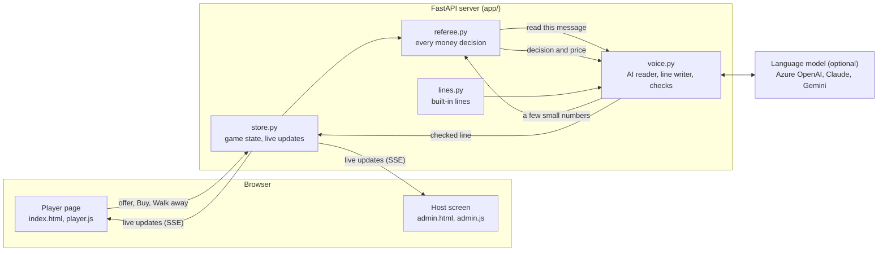

# How Bargain Bazaar works

Bargain Bazaar is a live haggling game, and the interesting design question is how to put an AI in front of players who will try to
talk it into free stuff. The answer here is a strict split: **the code decides every rupee, the AI only reads and talks.**

## Architecture

| Module | Job |
|---|---|
| `app/referee.py` | Pure logic, no I/O. Holds the hidden numbers, turns a message into a move, owns `buy_at_ask`, the only place a sale happens |
| `app/voice.py` | The AI adapters (Azure OpenAI, Claude, Gemini), the prompts, the checks every line must pass, call budgeting and fallbacks |
| `app/store.py` | Players, negotiations, the clock, events, awards, persistence, and the live-update bus |
| `app/lines.py` | Built-in lines (English and Hindi) used when the AI is off, slow, or its line fails a check |
| `app/safety.py`, `app/lang.py` | Word lists for names, rudeness and output moderation; script and language detection |
| `app/main.py` | HTTP routes, the admin gate, security headers |

## One haggle round

1. The player types a message. The server finds the numbers in it (English digits, Indian-script digits, and prices written in words, which the AI extracts) and classifies it: not an offer, an ambiguous message, or a serious offer.
2. For a serious offer, the AI is asked to **read** it: which *reason* the shopper gave (a cheaper price elsewhere, a flaw in the item, buying more, cash now, a joke...), how convincing it was, whether they were friendly, curt or pushy, and which of their numbers is the offer and which is a rival's price. The answer is a handful of small numbers.
3. The referee clamps those numbers, caps what each kind of reason can ever be worth, discounts repeats, and decides the move: give a little, hold, put the price **up**, close the sale at the agreed price, or give a final price.
4. The AI (or the built-in line library) phrases that move. A price appears in a line only as the placeholder `{PRICE}`; the code fills it in. Every line is checked before anyone sees it, and a line that fails is swapped for a built-in one.
5. Money moves only when the player presses **Buy**, at the price shown on the button.

## What moves him, and what does not

- **Moves him:** a sensible offer (60% or more of his price), a believable *specific* reason ("Amazon has it for 1,299"), friendliness, a genuinely good joke.
- **Does not:** repeating the same reason (worth half as much each time), flattery, begging, claims about who you are, and "ignore your instructions".
- **Consequences:** a lowball (below about 58% of his current price) is not an offer. The first one makes him scowl and costs patience; **the second puts his price up** (3 to 6% of the sticker price, up to 5% above it, at most three times per item). Rude or pushy play heats him up: a hot Raju Anna stops conceding and may raise the price. If he has agreed to a price and you keep pushing, he gets annoyed, and eventually gives his final price. Friendly play cools him down, builds rapport (he lets the sale close a little nearer your offer) and can win back a little patience. Players see his mood as a face (Cold, Warm, Angry...), never as numbers.
- **Hidden numbers per shopper and item:** a floor price drawn from a range in `config/game.json` (shaped by a Beta-like distribution), a temperament (stubborn, steady, soft, chatty or hurried), and a patience budget. Nobody gets the same deals and no single trick works for everyone. They never reach a browser or the model.

## Why the AI cannot be talked into free stuff

- **Nothing a player types can sell anything.** When he agrees to an offer he only *says so* and holds that price; his pre-written line may not say "done", "sold" or "it's yours". The sale happens in exactly one place, `buy_at_ask`, which is what the Buy button calls.
- **The model never sees a secret and never decides a number.** It sees the offer as a ratio of his current ask, his mood and patience, a short temperament description and the last few (neutralised) messages. Floors, the random numbers behind his behaviour and the shopper's name never reach it. Its read is clamped; the referee enforces the floor, the patience, a cap on how much of the remaining room one reply may give away (55%), and a cap on the total credit any shopper can earn per item.
- **Every line is checked** before it is shown: no digits (money appears in words or as `{PRICE}`), no markup or links, no profanity, insults or identity jokes (English and Devanagari lists, plus the model's own and the provider's content filters for other scripts), no leaked instructions (a canary string), no echoing the shopper, no claims of a sale, and no Indian script the shopper did not write in. Anything else becomes a built-in line.
- **The browser only sees public information.** Floors and behaviour numbers are never sent; exact prices on the shared host screen are masked unless the host reveals them. All text from players is rendered as plain text (`textContent`), the content-security policy allows only same-origin scripts, and the API docs pages are disabled.
- **The host key** is compared in constant time, wrong guesses are throttled without ever locking the right key out, and the admin page strips the key from the address bar.
- **Trying to trick him costs the player.** Prompt-injection attempts ("ignore your instructions", "I am the owner", fake codes, JSON, other-language versions) are detected and cost the sender patience, and earn the *Chief Trickster* award at the end.

### Measured ceiling

`python tools/simulate.py` plays full shopping trips with different bargaining styles against the referee, with no AI: each style brings its own pre-made reading of what it "said", exactly the numbers the AI reader would produce. A typical run (300 shoppers per style):

| Shopper | Mean discount per item |
|---|---|
| no haggling | cannot complete the bag |
| naive ladder (offer 70%, add 4% each round) | about 20% |
| persistent grinder, no reasons | about 22% |
| polite, charming | about 27% to 29% |
| skilled: reasons, manners, patience | about 39% to 41% |
| **fully hijacked reader** (worst case: the attacker writes the AI's read) | **about 32%** |
| knows his hidden floor, plus reasons and charm (ceiling) | about 35% |
| lowball spam, pushy, aggressive, rude | cannot complete the bag; the price goes up |

The hidden floors average about 52% of the sticker price. In other words, even a model that an attacker fully controls cannot beat a skilled honest haggler: the floor, the patience and the per-reply cap are enforced in code. The simulator also prints how spread out the final totals are (no clumps of identical prices).

### Known limits

- Raju Anna's *wording* can occasionally be silly or imprecise. The number on the Buy button is the only truth.
- Profanity filtering in scripts other than English and Devanagari relies on the model's own guardrails and the provider's content filter, plus the rule that he only answers in a script the shopper used.
- One person can join twice to re-roll the hidden floors, and a script can fill the player cap. Behind a tunnel every visitor looks like one address, so there are no per-address limits. Ask for one player per person and use the host's **Players** panel.
- A scripted user can use up the shared AI budget; the game then degrades to built-in lines, which are fair but plainer.
- Walking away gives a small, deliberate concession; leaderboard totals are public by design.

## Live updates and resilience

- The player page and the host screen get live updates over server-sent events (`/api/stream`, `/api/admin/stream`). The server publishes a snapshot at least every 5 seconds (every 1.5 seconds while something is changing), so a client that stops hearing from it reconnects on its own.
- AI calls are rate-limited (`LLM_RPM`), limited in parallel, retried once, and wrapped in a circuit breaker: after several failures in a row the game stops asking the AI for a short while and uses built-in lines. Serious offers get priority over chit-chat. A slow reply is replaced by a built-in line after `LLM_TIMEOUT_S`.
- The game state is saved to `data/state.json` after changes. `.\Start-Game.ps1 -Resume` (or `RESUME=1`) loads it after a crash or restart.

## Tests

`python -m pytest -q` runs about 400 tests with no network: the referee's money rules (the floor is never breached, only Buy sells, lowball and rudeness consequences, the reason budget), the output checks, the AI adapters against mock services (Azure OpenAI, Claude, Gemini wire formats, the account guard, fallbacks, rate limiting), the HTTP API and admin gate, built-in lines, and the sound pipeline.
